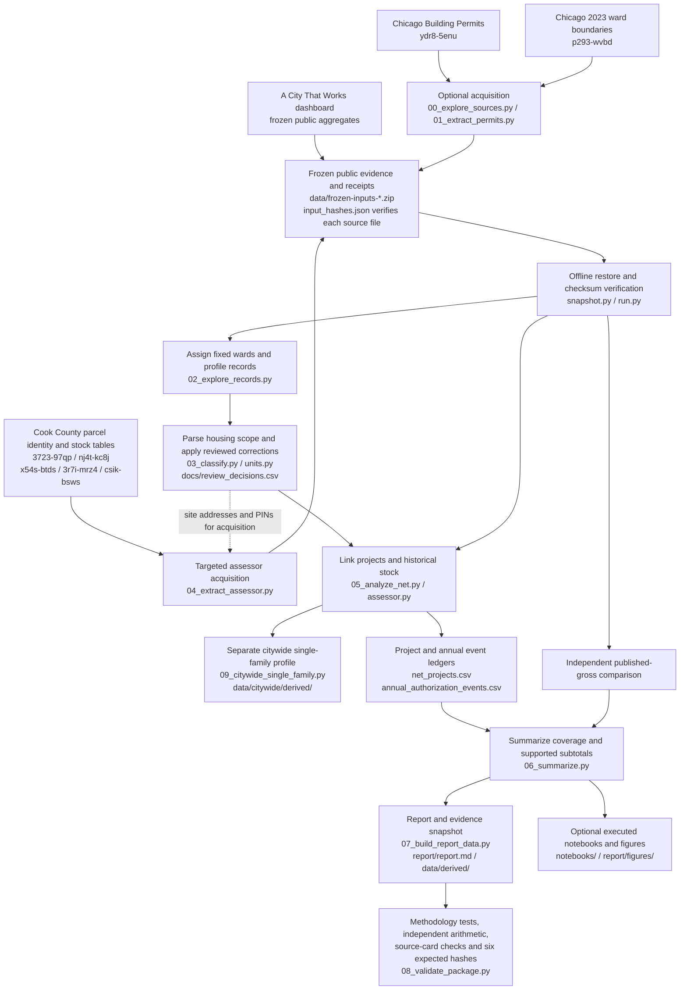
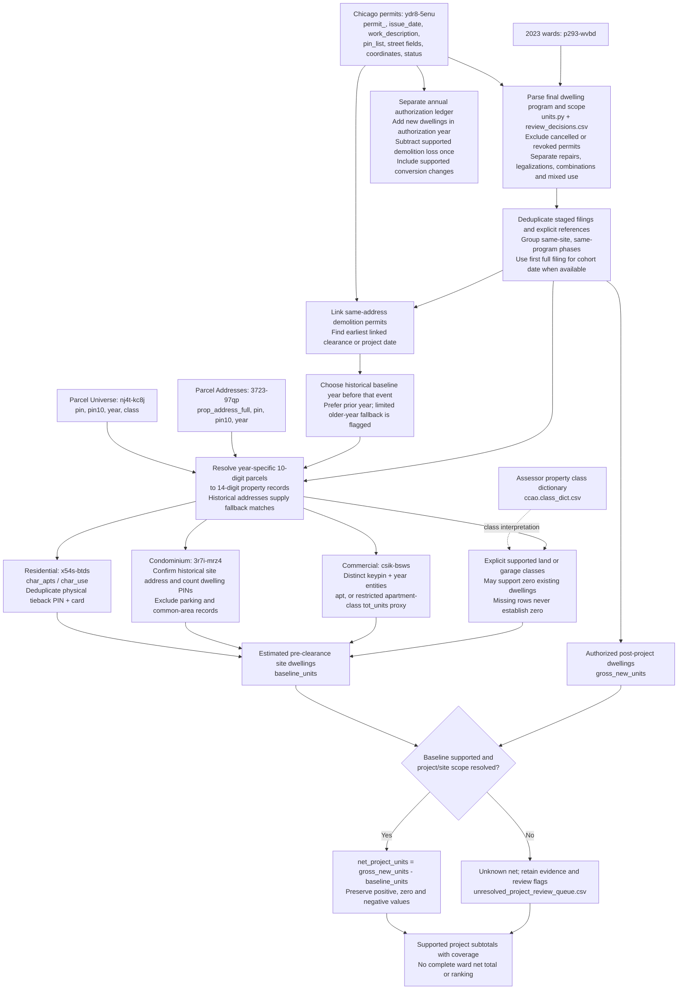

# Chicago net permit calculation

[](https://github.com/MisterClean/chicago-net-permit-calculation/actions/workflows/ci.yml)
[](LICENSE)

Reproduce a source-level audit of how building permits change the existing housing stock, rather than counting every permitted dwelling as a new addition.

**Project net units = authorized post-project dwellings − pre-clearance existing dwellings.** Negative and zero results remain in the measure. Permits are authorizations, not completed construction.

The analysis covers **January 1, 2023–October 8, 2026**, using the October 22, 2026 permit snapshot. The main report covers detailed historical-stock linkage in Wards **32, 1, and 47**. A separate citywide principal single-family profile adds historical assessor responses collected October 26, 2026 and reports supported subtotals with coverage for all 50 wards.

## Finding and limit

In the matched Ward 32 principal single-family cohort, 104 new homes replace an estimated 171 existing dwellings: **-67 net units**. Another 25 single-family projects remain unresolved. Across all classified new projects, supported baselines cover only **42.3% of gross units**. These are selected, matched projects: **the analysis does not establish a full ward net total or rank wards by net production**.


Read the [full report](report/report.md), [methodology](docs/methodology.md), [source exploration](docs/source_exploration.md), and [validation](VALIDATION.md). The two [executed notebooks](notebooks/) include portable HTML readouts and inspectable Python code.

## Data flow: public sources to reproducible outputs

Live acquisition saves selected public records and request receipts. Offline replay starts from the bundled snapshot and makes no network requests. The published dashboard is a comparison benchmark; it does not supply the independent net calculation.



All targets are ordinary repository files. No warehouse, private service, hosted app runtime, or machine-specific directory is required.

## How net permitted units are derived

The principal new-construction calculation uses the permit's authorized final dwelling program and a historical estimate of the **same site's stock before clearance**. These upstream sources have different grains and must be reconciled before subtraction.



For example, replacing a two-flat with one house gives **1 − 2 = −1 net project unit**. Its demolition and replacement can fall in different years; the annual ledger records each in its own year. Do not add the two measures together.

Conversions use explicit before/after counts or declared increments; possible legalizations and conflicting stock estimates are withheld from physical-stock subtotals. New accessory dwellings use their authorized additions when no linked housing demolition makes the scope uncertain. Ambiguous retained buildings, overlapping sites, parcel assemblies, or incompatible unit counts remain review cases. See [methodology](docs/methodology.md), [scope parsing](code/units.py), [stock estimation](code/assessor.py), and [project/event calculation](code/05_analyze_net.py).

## Reproduce

Only **Python 3.11+** is required for the core analysis. There are no Python package dependencies, accounts, credentials, API keys, or network calls in offline replay.

```bash
git clone https://github.com/MisterClean/chicago-net-permit-calculation.git
cd chicago-net-permit-calculation
python code/run.py --offline
```

The command restores 495 hash-verified frozen source files from three ZIP bundles in `data/`, reconstructs geography and permit classifications, joins historical assessor characteristics, regenerates project/event ledgers and the Markdown report, runs the methodology and snapshot regression suite, and independently verifies **six expected core-output SHA-256 hashes**. Source files are restored to ignored `data/raw/`; the two large intermediate caches are regenerated.

To rerun notebook cells and regenerate the three figures:

```bash
python -m pip install -r requirements-notebooks.txt
python code/run.py --offline --notebooks
```

The saved notebooks also run in a conventional Jupyter Python kernel after restoring the source snapshot. An included standard-library executor runs the trusted project notebooks without Jupyter. To inspect source hashes and independent arithmetic after a run:

```bash
python code/validate.py
```

## Citywide single-family analysis

```bash
python code/run.py --offline --citywide-single-family
```

This separate profile reruns geography, scope classification, project linkage, and historical-stock estimation across all wards. It independently recounts every supported baseline from frozen residential cards or supported zero-stock classes and verifies a separate set of expected output hashes. It does not overwrite the three-ward report or its configuration. No credentials or network calls are needed.

See [citywide methodology and results](docs/citywide_methodology.md), [ward subtotals and coverage](data/citywide/derived/ward_summary.csv), [project-level evidence](data/citywide/derived/single_family_projects.csv), and [reviewed scope decisions](docs/citywide_scope_review.csv). Wards with no supported projects have an unknown subtotal, not an invented zero. The supplemental source selection targets single-family candidates; it does not establish citywide all-housing net totals.

## What is included

| Path | Purpose |
| --- | --- |
| `code/` | Acquisition, geography, scope parser, project deduplication, historical-stock linkage, reporting, and notebook code |
| `data/frozen-inputs-*.zip` | Frozen public-source responses and exact non-secret request receipts |
| `data/input_hashes.json` | Per-file source SHA-256 hashes |
| `data/replay_expected_hashes.json` | Six expected core-output hashes; see [data provenance](data/README.md) |
| `data/derived/net_projects.csv` | Project-level findings, dates, baselines, matching evidence, and uncertainty |
| `data/derived/annual_authorization_events.csv` | Additions/removals in their authorization years; distinct from project impact |
| `data/derived/unresolved_project_review_queue.csv` | Remaining projects ordered for review |
| `docs/review_decisions.csv` | Explicit record-level scope corrections |
| `docs/citywide_scope_review.csv` | Audited citywide scope exclusions and one withheld condo-site estimate |
| `data/citywide/` | Separate citywide configuration, source manifest, results, coverage and expected hashes |
| `data/benchmark_history.json` | Previous rules version and expected benchmark hashes |
| `notebooks/` | Two executed notebooks, 13 code cells, portable HTML readouts |
| `report/` | Regenerated GitHub-readable report and analytical PNGs |
| `tests/` | Scope, identity, timing, geography, and missing-value regression tests |

## Sources and handling

The inputs include Chicago Building Permits (`ydr8-5enu`), official 2023 ward boundaries (`p293-wvbd`), Cook County annual parcel universe/address/residential/condominium/commercial extracts, the assessor class dictionary, and a frozen aggregate snapshot of [A City That Works’ dashboard](https://housing.acitythatworks.org/permitting). See [source attribution and license scope](SOURCES.md).

Recent Chicago permit PINs are 10-digit parcel identifiers; assessor characteristics use 14-digit identifiers and multiple record grains. The pipeline resolves historical identities, distinguishes physical building cards from condo parking/storage, deduplicates staged filings, and chooses a pre-clearance baseline. Missing or conflicting stock remains unknown. A missing assessor row is never assumed to mean vacant land.

The **project cohort** and **annual authorization ledger** are separate views. A two-flat demolished in 2022 and replaced by one house in 2024 contributes −1 to that project's impact, but −2 in 2022 and +1 in 2024 to the annual ledger. Combining the two views would double-subtract the demolition.

## Live acquisition and refresh

`python code/run.py --acquire` resumes cached requests; it does not silently replace this snapshot. For a new snapshot, work in a separate copy, deliberately update dates/configuration and request caches, and preserve this release and expected hashes. Source revisions, historical-status changes, and assessor updates can change results. New data requires new validation and an explicitly versioned benchmark.

## Open-source scope

The original analysis code, report text, and documentation are MIT licensed. Third-party source data retains its own source terms and attribution; it is not relicensed as software. This repository reproduces all analytical results with Python and optional open-source notebook dependencies. All paths are resolved relative to the checkout; it can be cloned into any directory. Public-file checks inspect compressed evidence as well as code and documentation.

Contributions are welcome; see [CONTRIBUTING.md](CONTRIBUTING.md). The next extension is to test where net additions occur within high-resource areas and whether collector/arterial frontages carry a disproportionate share—without assuming road class alone establishes noise, pollution, or danger.

## Project checks and support

GitHub Actions replays the focused analysis on Python 3.11, 3.12, and 3.13, executes the notebooks on Python 3.12, and separately replays the citywide single-family profile. Actions are pinned to commit hashes; Dependabot proposes dependency updates. The core replay uses only the standard library.

Run `python code/check_public_files.py` to verify release checksums and scan public files, including ZIP/gzip members, for local-path and credential patterns. This is a pattern-based guard; review new contributions and source selections before publishing them. To create a portable ZIP and refresh `MANIFEST.sha256`, run `python code/make_public_archive.py`.

Use [issues](https://github.com/MisterClean/chicago-net-permit-calculation/issues) for reproducible bugs or source-backed methodology questions, [CONTRIBUTING.md](CONTRIBUTING.md) for contribution guidance, and [SECURITY.md](SECURITY.md) for private vulnerability reporting. Cite this project using [CITATION.cff](CITATION.cff).

Methodology changes and benchmark versioning are documented in [CHANGELOG.md](CHANGELOG.md). Rules 1.1.0 add scope regression cases and a condominium site-address guard; derived benchmarks are explicitly versioned rather than silently retaining obsolete hashes.
