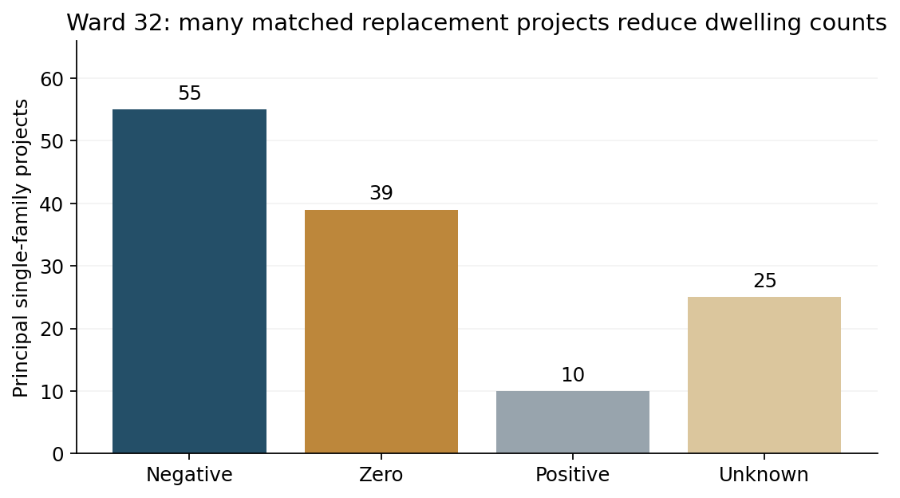
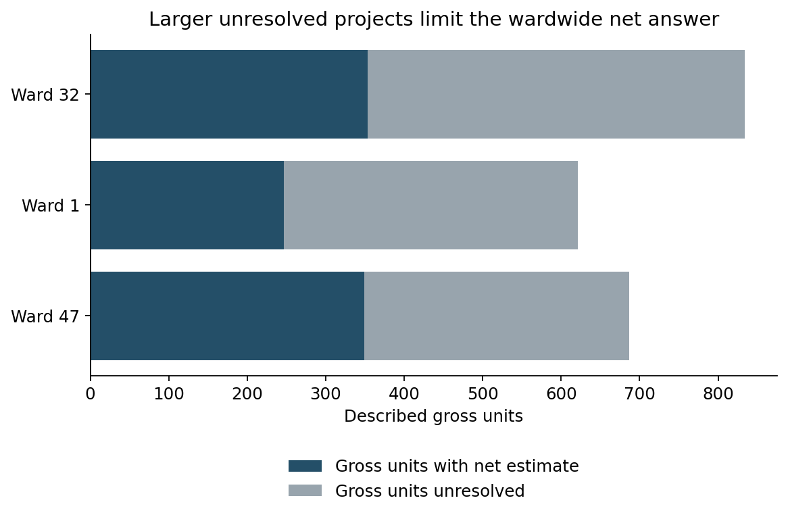
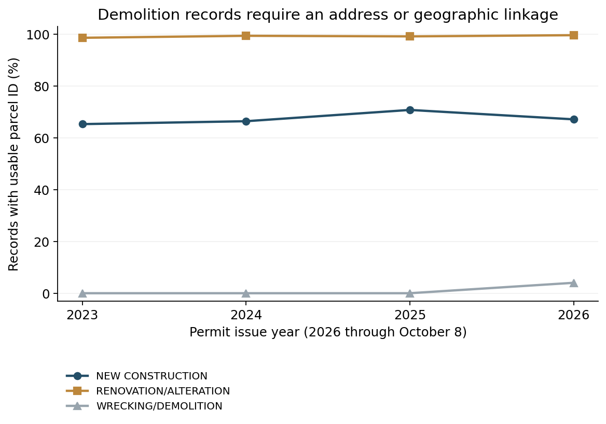

# Replacement housing changes Ward 32’s permit picture

A reproducible audit of gross construction counts, historical housing stock and the limits of a net-permitted-units measure.

## Executive Summary

- **Matched single-family projects show a housing loss.** 104 Ward 32 projects describe 104 new principal homes, replacing an estimated 171 existing dwellings: **-67 net units**. This is an assessor-based estimate of project impact, not completed housing production.
- **Coverage limits the wardwide answer.** 25 of 129 classified single-family projects remain unresolved. Across all classified new projects, supported net estimates cover only **42.3% of described gross units**. A full Ward 32 net total or citywide net ranking is not established.
- **Keep multifamily construction visible, with a clearer definition.** The publisher reports 677 multifamily units and fifth place for Ward 32. The description audit identifies **35 townhouse units** that should be shown separately and several examples where permit type or an occupancy code gives the wrong unit count.

## Replacements change the single-family story

Among the 104 matched Ward 32 single-family principal-building projects, **55 reduce the estimated dwelling count, 39 replace homes one for one, and 10 add units**. Another 25 classified projects have unresolved site or baseline evidence. Detached accessory dwellings are a separate category.

This supports the proposed replacement mechanism within the matched cohort. It does not establish a causal effect of an alder, a completed-stock change, or the net impact of every permit in the ward. Assessor characteristics may lag physical changes.

The sign also remains negative in the narrower native-PIN subset with no baseline flags: **-65 units across 102 projects**. These subsets are selected by matchability, not random samples; the comparison does not remove assessor error.

### Inspect the underlying sites

The examples below show why a permit for one house can contribute a negative net count. Baselines precede the earliest same-address demolition linked within five years. Their source, year, unit count and permit identifiers remain in the project ledger. A same-address link is a documented matching rule; complex assemblies and retained buildings require further review.

| Site | Permits | New units | Existing units | Net units | Baseline year |
| --- | --- | --- | --- | --- | --- |
| 2159 N OAKLEY AVE | ["100962980"] | 1 | 3 | -2 | 2021 |
| 3523 N OAKLEY AVE | ["101000816"] | 1 | 2 | -1 | 2022 |
| 3019 N LINCOLN AVE | ["100998598"] | 3 | 4 | -1 | 2022 |
| 1457 W ROSCOE ST | ["100980037"] | 3 | 4 | -1 | 2021 |
| 2329 W FULLERTON AVE | ["100970795"] | 4 | 0 | 4 | 2022 |

## A matched subtotal is not the ward total

The independent classifier identifies **239 new projects describing 834 units** in Ward 32 after stage deduplication and current cancellation screening. The 175 projects with supported baselines describe 353 gross units and yield **+77 estimated net units**. The remaining 64 projects are unresolved and are concentrated in larger developments.

Do not subtract the matched losses from all published gross units and label the result net. Any ordering of supported subtotals must be labeled as partial and shown with coverage; it is not a complete ward ranking or a lower bound. Unknown removals can reduce a result and unknown additions or scope changes can increase it. The project and unit denominators are both retained for inspection.

| Ward | Projects | Gross units | Supported projects | Gross units with baseline | Partial net subtotal |
| --- | --- | --- | --- | --- | --- |
| 32 | 239 | 834 | 175 | 353 | 77 |
| 1 | 107 | 621 | 70 | 247 | 162 |
| 47 | 170 | 687 | 123 | 349 | 190 |

## Gross multifamily counts remain a useful companion

The frozen publisher snapshot reports **827 Ward 32 units: 150 single-family and 677 multifamily**, with a single-family share of 18.1% versus 9.0% citywide. Ward 32 ranks fifth under the publisher's multifamily labels.

These figures reproduce the publisher's aggregate snapshot; they are not an independently validated apartment inventory. Our new cohort uses current-source status, description-level scope checks and a full-building cohort date where available, so its totals should not be forced to match the earlier snapshot.

For the new measure, show principal single-family homes, detached accessory dwellings, multifamily buildings and townhouse groups separately. Five Oakdale townhouse groups describe **35 units** across foundation and full-building filings. Counting both stages would produce 70; treating every multi-unit filing as one multifamily building would obscure the building type.

| Ward | Published gross units | Published single-family | Published multifamily |
| --- | --- | --- | --- |
| 1 | 643 | 49 | 594 |
| 2 | 246 | 13 | 233 |
| 3 | 1194 | 6 | 1188 |
| 4 | 257 | 17 | 240 |
| 5 | 67 | 11 | 56 |
| 6 | 25 | 9 | 16 |
| 7 | 46 | 3 | 43 |
| 8 | 81 | 2 | 79 |
| 9 | 29 | 29 | 0 |
| 10 | 86 | 3 | 83 |
| 11 | 185 | 69 | 116 |
| 12 | 73 | 36 | 37 |
| 13 | 12 | 12 | 0 |
| 14 | 29 | 6 | 23 |
| 15 | 29 | 7 | 22 |
| 16 | 116 | 4 | 112 |
| 17 | 14 | 9 | 5 |
| 18 | 11 | 5 | 6 |
| 19 | 28 | 28 | 0 |
| 20 | 575 | 43 | 532 |
| 21 | 46 | 20 | 26 |
| 22 | 192 | 6 | 186 |
| 23 | 17 | 15 | 2 |
| 24 | 327 | 50 | 277 |
| 25 | 304 | 4 | 300 |
| 26 | 280 | 22 | 258 |
| 27 | 3058 | 44 | 3014 |
| 28 | 538 | 13 | 525 |
| 29 | 206 | 19 | 187 |
| 30 | 123 | 31 | 92 |
| 31 | 19 | 11 | 8 |
| 32 | 827 | 150 | 677 |
| 33 | 218 | 48 | 170 |
| 34 | 1325 | 0 | 1325 |
| 35 | 147 | 50 | 97 |
| 36 | 198 | 61 | 137 |
| 37 | 92 | 46 | 46 |
| 38 | 59 | 14 | 45 |
| 39 | 35 | 32 | 3 |
| 40 | 180 | 48 | 132 |
| 41 | 57 | 44 | 13 |
| 42 | 853 | 1 | 852 |
| 43 | 303 | 46 | 257 |
| 44 | 415 | 26 | 389 |
| 45 | 84 | 42 | 42 |
| 46 | 338 | 1 | 337 |
| 47 | 666 | 136 | 530 |
| 48 | 533 | 3 | 530 |
| 49 | 33 | 4 | 29 |
| 50 | 34 | 19 | 15 |

## What the source exploration changed

The exploration examined a source of **851,077 Chicago permit records**, downloaded **200,453 records**, and retained all **124,831** permit types in the reporting window. Partition counts reconcile; database IDs and exact permit-number strings are unique in the extract.

**Permit type is not the work scope.** New Construction includes garages, tents, cranes, revisions and some conversions. The published article also acknowledges missing description classifications and excluded demolitions. The independent parser preserves evidence spans, explicit before/after pairs and record-level review decisions.

**Historical PIN handling is essential.** Populated recent permit PINs are 10-digit parcel IDs. The county's characteristics use 14-digit property/unit identifiers. Demolition PINs are absent through 2025. Resolve through historical Parcel Universe and property addresses; do not pad a 10-digit parcel ID into an invented condominium unit PIN.

**Assessor tables have different grains.** Small-building records are PIN/year/card; condo records are unit-level. In the targeted historical condo extract, 1,089 of 2,851 rows are parking or storage. The two Chicago commercial reassessment extracts contain 68,113 rows and **no populated apt field**. Generic total-units values can include hotel rooms or commercial space, so ambiguous baselines remain unknown.

**Status and geography need explicit rules.** 357 recent records have cancellation/revocation in status or milestone. Current status is not historical status as of issuance. Expiration alone is not treated as cancellation. The issue date generally means ready to issue subject to fees, not completion. All geography uses the 50 official 2023 ward polygons; missing and outside coordinates remain unassigned.

### Three reproducible scope checks

- **Ward 1, permit 101050179:** the description erects one house and ends with occupancy R-5. The reference dashboard lists five units; the review records one house. An occupancy class is not a unit count.
- **Ward 47, permit 101032126:** the work replaces a garage; the adjacent six-unit condo building is explicitly not in scope. The reference lists six units; the new classifier excludes those dwellings.
- **Ward 32, permit 101075042:** the description converts commercial ground-floor space to one new dwelling. The five-unit figure describes the building's resulting residential program; it is not five newly constructed homes.

These are specific observed cases, not an estimated error rate for the publisher's full dataset. All overrides and complete descriptions are retained for audit.

## Recommended measurement contract

**Project net units = authorized post-project site dwellings − documented pre-project site dwellings.** Count the same site on both sides, include retained housing, and preserve negative and zero results. Count vacant dwellings in the existing stock. Ownership conversions alone contribute zero. Legalizing an existing unit does not establish a new physical dwelling; possible legalizations are flagged.

**Principal single-family scope (rules 1.1.0).** A new house must be the object of the construction scope. A new roof, deck, porch, pool, stair, equipment installation or interior renovation at a house does not create a new principal dwelling, even when the permit type says New Construction. Conversely, an explicit new principal house remains eligible when filed as Renovation/Alteration. A construction-type or occupancy label is not evidence of dwelling construction. Legalizations of already-built work and condo-unit combinations remain outside the new-house cohort. One-dwelling mixed-use buildings are tracked separately from principal single-family houses. Reviewed exceptions and source descriptions are retained in docs/review_decisions.csv and docs/citywide_scope_review.csv.

**Condominium site scope.** A native 10-digit condo parent PIN does not establish that every dwelling on the parent parcel is removed by a house permit. When available historical condo addresses do not match the permit site, withhold the baseline and net estimate and retain condominium_site_scope_unverified. This guard does not certify retained-building or complex-site scope simply because an address matches.

**Project identity.** Resolve explicit permit references and same-site foundation/full filings with the same unit program. Count a program once. Multiple principal buildings sharing a site, conflicting programs, retained housing and unclear parcel assemblies remain review cases. Use the first full-building filing for a project cohort when present; show partial-only projects as pipeline.

**Existing-stock baseline.** Use a historical assessor year before the earliest linked project/clearance event. A prior year immediately before the construction permit may already describe cleared land. Resolve 10-digit parcel identities to year-specific 14-digit records; count distinct buildings/cards, filter condo parking/storage, and avoid repeated commercial entity rows. A missing row is not evidence of zero housing. Intervening housing authorizations require stock review rather than an assumption that the work was completed.

**Two date views.** Project cohorts attach the full before/after impact to the housing project's cohort date. An annual authorization ledger records additions and removals in their permit years, subtracting each removal once. For a two-flat demolition in 2022 and a replacement house in 2024, project impact is −1; the annual ledger is −2 in 2022 and +1 in 2024. Never subtract the original two-flat again from the 2024 ledger.

**Multifamily companion measures.** Publish gross newly authorized dwellings in buildings with two or more units, plus net multifamily stock authorized: multifamily dwellings afterward minus multifamily dwellings beforehand. A two-flat becoming one house means −1 total dwelling and −2 multifamily dwellings. Keep townhouse groups and detached accessory dwellings separate where the building definition is uncertain.

**Release rule.** Publish coverage beside every subtotal and withhold complete ward totals/rankings while material baselines or scope remain unresolved. Exploratory ordering of supported subtotals is permitted only with an explicit partial-estimate label and unresolved-project counts; include positive and zero projects in every net subtotal. Compare 2023–2025 complete years separately from 2026 YTD. Fix ward boundaries for geographic comparisons and do not equate permit issuance with construction completion or causal political credit.

## Keep annual authorizations separate from project impact

Ward 32's reviewed ledger contains **228 building-demolition episodes**, with estimated unit losses supported for 174 episodes. Those known episodes describe 329 removed dwellings. The 23 explicit conversion records have a declared net change of -15, before withholding possible legalizations and baseline disagreements from physical-stock estimates.

The annual figures below are **known-event subtotals, not complete net totals**. Unknown events and unresolved candidates are retained in the ledger. The annual subtotal and project-cohort subtotal differ because their timing and supported populations differ. They must not be combined.

| Ward | Year | Known event subtotal | Unknown events | Known events |
| --- | --- | --- | --- | --- |
| 32 | 2023 | 73 | 18 | 97 |
| 32 | 2024 | 87 | 26 | 129 |
| 32 | 2025 | 148 | 26 | 107 |
| 32 | 2026 | 183 | 25 | 95 |
| 1 | 2023 | 4 | 33 | 46 |
| 1 | 2024 | 75 | 26 | 68 |
| 1 | 2025 | 117 | 34 | 45 |
| 1 | 2026 | 277 | 31 | 43 |
| 47 | 2023 | 169 | 24 | 90 |
| 47 | 2024 | 57 | 26 | 108 |
| 47 | 2025 | 139 | 22 | 110 |
| 47 | 2026 | 33 | 7 | 64 |

## Reproduce the result and finish the unresolved cases

The package contains frozen compressed source responses, exact non-secret request URLs and retrieval timestamps, source dictionaries, configuration, classification rules, review decisions, complete project/event CSVs, two executed notebooks, tests, and an open-source Python pipeline that generates the reviewed report data and Markdown.

Run `python code/run.py --offline` to recompute the three-ward analysis from the saved inputs. Run `python code/run.py --offline --citywide-single-family` for the separate citywide principal-house profile and its own expected output hashes. Its supplemental historical assessor responses were collected October 26, 2026; the permit cohort still ends October 8, 2026. The command regenerates this Markdown report, all project and event ledgers, and the reviewed evidence snapshot. Run `python code/validate.py` to check the six frozen core-output hashes. Run `python code/execute_notebooks.py` to rerun the notebook companions. No credentials or live connections are required for replay. Acquisition scripts resume cached requests; a live refresh is a separate new snapshot, not a replay of this one.

The next substantive task is the unresolved-project review queue, sorted by gross-unit impact. Resolve parcel assemblies, larger commercial/apartment baselines, retained buildings and mismatched existing-unit counts before releasing a full ward net total. The current evidence supports the replacement mechanism in the matched single-family cohort, while leaving Ward 32's complete net ranking open.
